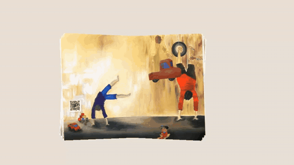

# Teste MindAR.js

Realidade aumentada na web com rastreamento de imagem, usando MindAR.js e A-Frame. Reconhece uma ilustração impressa num livro e projeta o modelo 3D por cima, sem precisar de marcadores com moldura.

<p align="center">
  
</p>

> A animação é uma gravação da demo publicada, feita com uma câmara simulada (não é um telemóvel real).

**Demo:** https://teste-site-mind-ar-js.vercel.app

Abre a demo num telemóvel, permite o acesso à câmara e aponta-a para a ilustração `imagem pag-12.png`.

## Como funciona

- O alvo de imagem está compilado em `assets/02_Bolsos.mind`.
- Quando a câmara reconhece a ilustração, o modelo `.glb` (escala 3) fica ancorado sobre ela e a animação do modelo corre com `animation-mixer`.

## Tecnologias

HTML, CSS e JavaScript · A-Frame 1.4.2 · MindAR.js 1.2.5 · A-Frame Extras 6.1.1 (animações)

## Estrutura

```
index.html                              # cena A-Frame + MindAR
assets/
├── 02_Bolsos.mind                      # alvo de imagem já compilado
└── 02_Bolsos.glb                       # modelo 3D
imagem pag-12.png                       # ilustração usada como alvo
qr-code mindAR Teste pag-12.png         # QR code para abrir a demo
docs/demo.gif                           # animação deste README
README.txt                              # documentação técnica
```

## Documentação técnica

Mais detalhes (configuração da câmara, escala e iluminação, como testar) em [`README.txt`](README.txt).
